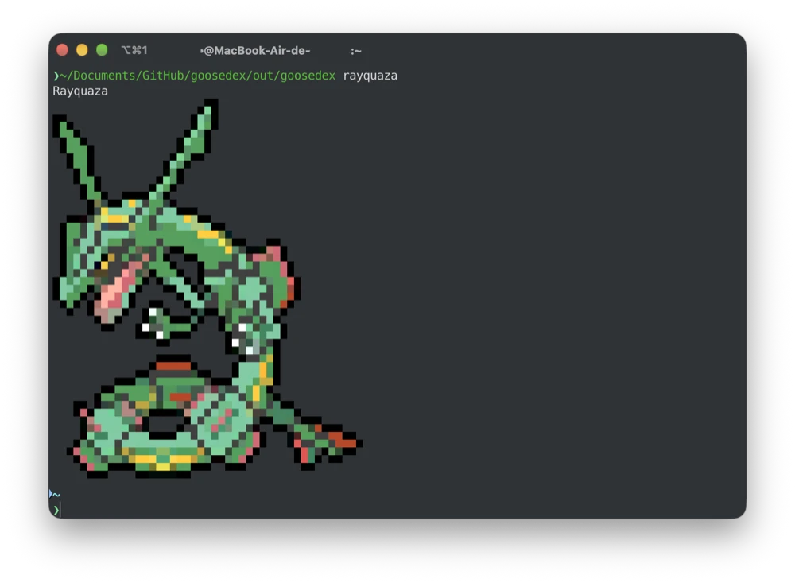

<div align="center">

# goosedex

[](https://github.com/aardappel/goose)
[](LICENSE)

A fast, lightweight Pokemon sprite viewer for your terminal written in [Goose](https://github.com/aardappel/goose).

A port of [zigdex](https://github.com/Decryptu/zigdex) to compare the two languages on the same program: same assets, same sprite format, byte-for-byte the same output.



</div>

## Features

- 🎲 Random Pokemon with 1/128 shiny chance
- ✨ Shiny variant support
- 🚀 Sprites embedded in binary (works offline)
- 📦 Single self-contained executable
- ⚡ Optimized for shell startup scripts

## Goose vs Zig

Both programs embed the same 1025 Pokemon and 447 alternate forms, and print identical bytes for every one of them, regular and shiny. Measured on macOS 27, Apple Silicon, with `./bench.sh` (hyperfine `-N`, 3000 runs of `random`):

| | goosedex | zigdex | pokeget | krabby |
|:---|---:|---:|---:|---:|
| Mean time | 1.21 ms | 1.15 ms | 1.81 ms | 4.15 ms |
| Peak memory | 1.73 MiB | 1.75 MiB | 3.59 MiB | 6.61 MiB |
| Binary size | 1.21 MB | 1.23 MB | 4.24 MB | 24.50 MB |

<sub>An empty compiled C program takes about 1.05 ms on the same Mac. pokeget 1.6.7, krabby 0.3.0, zigdex built with Zig 0.17 `-Doptimize=fast`.</sub>

| | goosedex | zigdex |
|:---|---:|---:|
| Embedded sprite data | 1,070,223 bytes | 1,076,521 bytes |
| Clean build (warm global caches) | 2.5 s | 7.3 s |
| Lines of code, program | 457 | 330 |
| Lines of code, build-time tools and build script | 819 | 435 |
| Lines of code, tests | 94 | 39 |

What the numbers say:

- **Speed:** zigdex starts about 0.07 ms sooner. goosedex's own work (argument parsing, lookup, inflate, render) costs almost nothing: it runs within a few microseconds of a Goose program that only prints `hi`. The gap is the Goose runtime's startup, chiefly that on macOS it opens each data stack's memory with a fault the first time it is used, which costs more than drawing a sprite (below).
- **Size and memory:** goosedex is slightly smaller on both counts, helped by its compressor beating Zig's standard library deflate at `.best`.
- **Code:** Zig's standard library brings a deflate compressor and decompressor; Goose's does not, so goosedex carries its own (`src/inflate.goose`, `tools/deflate.goose`), which accounts for most of the extra lines. Goose does bring a JSON reader, string helpers and a dictionary that kept the generator short.
- **Build:** the Goose compiler turns the whole program into one C file in well under a second, and the C compiler does the rest.

## Installation

### Manual Installation

Download the appropriate binary for your architecture from the [releases page](https://github.com/Decryptu/goosedex/releases) and add it to your PATH.

## Building

You need the [Goose compiler](https://github.com/aardappel/goose/releases) on your PATH (or `make GOOSE=/path/to/goose`) and a C compiler.

```bash
make
make test
./bench.sh
```

This will:

1. Build the sprite generator and run it over the `assets/` directory
2. Compile the program and the Goose runtime into one C file, then build `out/goosedex` with `cc -O2`
3. Embed all 1025 Pokemon sprites and 447 alternate forms directly into the binary

## Usage

```bash
# Random Pokemon (1/128 chance for shiny)
goosedex random
goosedex --random

# Specific Pokemon by name
goosedex pikachu
goosedex bulbasaur charmander squirtle

# By Pokedex number
goosedex 25
goosedex 1 4 7

# Force shiny variant
goosedex pikachu --shiny
goosedex random --shiny

# Hide Pokemon name
goosedex pikachu --hide-name
goosedex random --hide-name
```

## Shell Integration

Add to your `.zshrc` or `.bashrc`:

```bash
# Show random Pokemon on terminal start
goosedex --random --hide-name

# Or with fastfetch
alias fastfetch='goosedex --random --hide-name | command fastfetch --logo-type file-raw --logo -'
```

## Project Structure

```tree
goosedex/
├── src/
│   ├── main.goose       # Entry point and CLI
│   ├── args.goose       # Argument parser
│   ├── sprites.goose    # Pokemon lookup and display
│   ├── inflate.goose    # DEFLATE decoder
│   ├── tests.goose      # Unit tests
│   └── gen/             # Generated: sprite data and its tables
├── tools/
│   ├── generate_sprites.goose  # Build-time sprite embedder
│   └── deflate.goose           # DEFLATE encoder
├── assets/
│   ├── pokemon.json
│   └── colorscripts/
│       ├── regular/     # Normal sprites
│       └── shiny/       # Shiny variants
├── bench.sh
└── Makefile
```

## Implementation Details

### Compile-Time Sprite Embedding

- `tools/generate_sprites.goose` runs during the build and replays each ANSI sprite into a pixel grid
- Every sprite is stored as a palette plus two pixels per cell, with 256-color sprites converted to truecolor and transparent borders cropped
- Each Pokemon's regular and shiny sprites share one deflate stream, and all streams go into `data.bin`, which the generated module embeds with `embed_file`
- The compressor is zlib's level 9 strategy (hash chains, lazy matching) with whichever of a dynamic, fixed or stored block is smallest
- At runtime the sprite is inflated and drawn with half blocks, emitting only the color changes each cell needs and resetting colors at every line end

### Pokemon Lookup

- Case-insensitive name matching (`pikachu`, `PIKACHU`, `"Charizard (Mega X)"`)
- Slug matching (`charizard-mega-x`)
- Pokedex number (`25`, `150`)

Names and slugs are resolved with a binary search over a table sorted at build time. Unknown names are reported on stderr and make `goosedex` exit with status 1.

### Startup, and what Goose taught us

- The build uses `goose --standalone`, which puts the runtime in the program's C file so the C compiler drops what goosedex never calls. Against the default `goose build` it binds 34 symbols at launch instead of 86, and saves about 0.1 ms.
- Goose keeps a fixed array in static data only up to 256 elements (`MAXSTATICELEMS` in the compiler) and builds a longer one at startup, one store at a time. The tables are therefore arrays of 256-entry chunks behind `pokemon(i)` and `key(i)`.
- Every growable value lives on a data stack, and large fixed-size locals do too. On macOS the runtime reserves each stack's memory and opens it on first use from a fault handler, about 20 to 40 µs per stack. goosedex parses its arguments in a scope that ends before output starts, so the output buffer reuses the same, already open stack: two such faults per run instead of four.
- The output is built in one buffer and leaves in a single `write`; the random seed comes from `arc4random` rather than `os.random_seed`, which opens `/dev/urandom`.

## Command-Line Options

| Option | Short | Description |
|--------|-------|-------------|
| `--random` | `-r` | Display random Pokemon (1/128 shiny) |
| `--shiny` | `-s` | Force shiny variant |
| `--hide-name` | | Don't print Pokemon name |
| `--help` | `-h` | Show help message |

## Requirements

- Goose v2026.3 or later, and a C compiler
- Terminal with ANSI color support
- On Linux, glibc 2.36 or later (for `arc4random`)

## License

MIT
